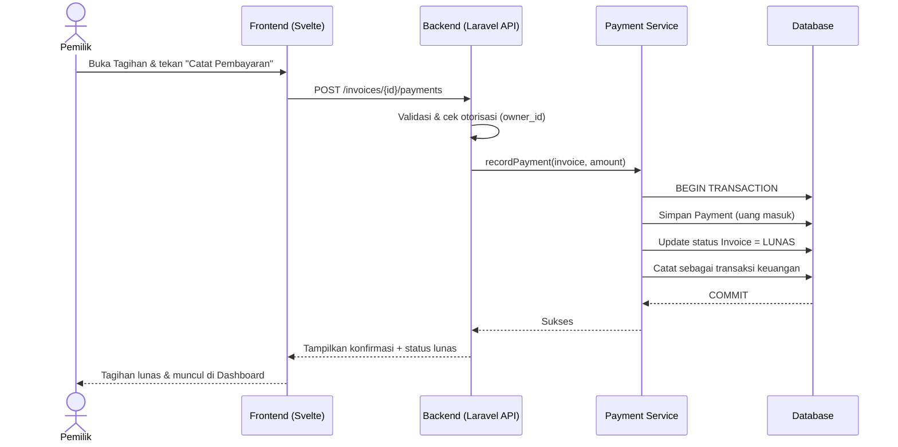
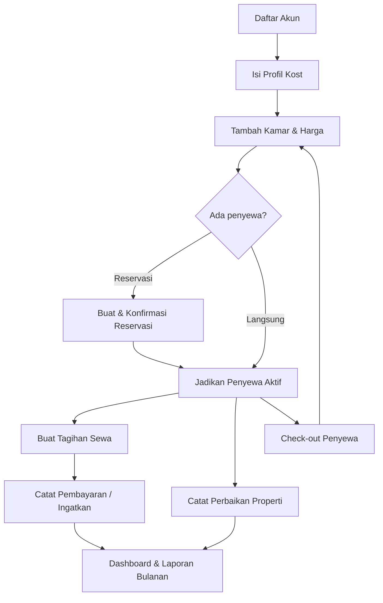
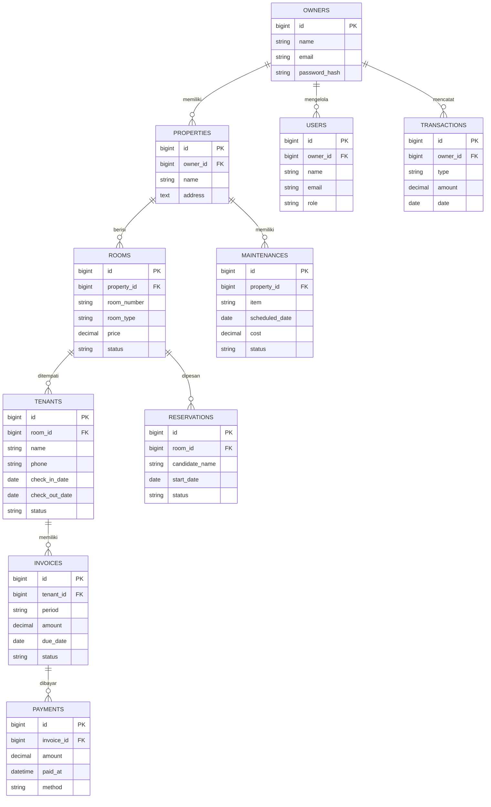

> **ARSIP NON-NORMATIF:** sumber sebelum konsolidasi. Gunakan hanya untuk melacak asal materi; requirement aktif ada di [indeks dokumentasi](../README.md).

# PRD — Project Requirements Document

## 1. Overview

**Kost Management System** adalah aplikasi web berbasis cloud (SaaS) yang membantu pemilik usaha kost mengelola properti sewa kamar secara terpusat dan rapi, dari satu perangkat apa pun (HP, laptop, atau tablet).

**Masalah yang diselesaikan:**

- Pemilik kost masih mencatat aktivitas secara manual (buku, chat, atau ingatan), sehingga sering lupa siapa yang sudah bayar, siapa yang akan jatuh tempo, dan kapan sewa berakhir.
- Riwayat keluar–masuk penghuni, perbaikan, dan keuangan tidak terdokumentasi, sehingga sulit membuat laporan bulanan dan memantau keuntungan.
- Sulit melihat kondisi kost secara cepat (kamar terisi/kosong, tagihan tertunggak, pengeluaran bulan ini).

**Tujuan utama:**

1. Menyediakan satu tempat untuk mengelola kamar, penyewa, pembayaran, reservasi, dan perawatan.
2. Mengingatkan pemilik tentang tagihan jatuh tempo dan masa sewa berakhir agar tidak ada yang terlupa.
3. Menyajikan laporan keuangan bulanan (uang masuk, keluar, dan keuntungan bersih) yang mudah dibaca dan diunduh.
4. Mendukung banyak pemilik kost dalam satu platform, dengan **isolasi data antar pemilik (multi-tenant)** yang aman.

---

## 2. Requirements

**Fungsional (Utama):**

- Setiap pemilik kost membuat akun sendiri dan hanya dapat melihat/mengubah data miliknya.
- Pemilik dapat mengelola lebih dari satu properti kost dan menambah pengelola (staf) dengan hak akses terbatas.
- Semua transaksi keuangan (pembayaran, biaya perbaikan) tercatat dengan benar dan konsisten.
- Sistem menampilkan status kamar, tagihan, dan pengingat jatuh tempo secara otomatis.

**Non-Fungsional:**

- **Aman:** password terenkripsi, otorisasi per peran (pemilik vs pengelola), proteksi data antar tenant.
- **Andal untuk keuangan:** perhitungan uang masuk/keluar harus akurat dan memakai transaksi database agar tidak ada data setengah tersimpan.
- **Responsif:** tampilan nyaman digunakan di HP, tablet, dan laptop.
- **Cepat & modular:** kode terstruktur agar mudah dikembangkan (fitur per fase).
- **Teruji:** alur bisnis kritis (pembayaran, check-out, pembuatan tagihan) diuji otomatis.
- **Multi-tenant by design:** setiap data terikat pada `owner_id` (tenant).

**Asumsi:**

- Bahasa aplikasi: Indonesia.
- Mata uang: Rupiah (IDR).
- Pengguna: 1 pemilik dapat mengelola banyak kost; 1 kost dapat dibantu 1+ pengelola.

---

## 3. Core Features

Fitur di bawah ini **mengikuti kerangka roadmap yang telah disetujui**, dikelompokkan per fase.

### Fase 1 — Fondasi & Titik Pantau

- **Dashboard Ringkasan** — Halaman utama yang merangkum kondisi kost sekilas:
    - **Ringkasan Uang Bulan Ini** — total uang masuk, uang keluar, dan selisihnya untuk bulan berjalan.
    - **Status Kamar** — jumlah kamar terisi, kosong, dan akan segera kosong.
    - **Pengingat Jatuh Tempo** — daftar penyewa yang tagihannya jatuh tempo/lewat.
    - **Aktivitas Terbaru** — penghuni masuk, keluar, dan pembayaran terbaru.

### Fase 2 — Operasional Inti

- **Data Kamar & Harga** — Mengelola seluruh kamar dan harganya:
    - Daftar Kamar, Tambah & Ubah Kamar, Atur Harga Sewa (per kamar/tipe), Riwayat Kamar.
- **Data Penyewa** — Mencatat semua penghuni:
    - Daftar Penyewa, Tambah Penyewa Baru, Masa Sewa & Jatuh Tempo, Check-out Penyewa, Riwayat Penghuni.
- **Catat & Tagih Pembayaran** — Mengelola uang sewa:
    - Buat Tagihan, Catat Pembayaran Masuk, Status Tagihan (lunas/belum), Ingatkan Penyewa, Riwayat Pembayaran.
- **Reservasi Kamar** — Pemesanan kamar kosong sebelum masuk:
    - Kamar Kosong, Buat Reservasi, Status Reservasi (baru/konfirmasi/batal), Jadikan Penyewa.

### Fase 3 — Perawatan & Laporan

- **Catatan Perbaikan** — Mencatat kerusakan dan perawatan:
    - Daftar Kerusakan, Jadwal Perbaikan, Biaya Perbaikan, Riwayat Servis.
- **Laporan Keuangan** — Laporan uang masuk/keluar siap dilihat/unduh:
    - Ringkasan Bulanan, Rincian Pemasukan, Rincian Pengeluaran, Unduh Laporan.

### Fase 4 — Akun & Pengaturan

- **Akun & Pengaturan** — Mengatur akun dan identitas properti:
    - Daftar Akun, Masuk & Keluar, Lupa Kata Sandi, Profil Kost, Kelola Pengelola (akses staf).

---

## 4. User Flow

**A. Pemilik Kost Baru (Onboarding)**

1. Membuka aplikasi → memilih **Daftar Akun**.
2. Mengisi data akun pemilik → mengisi **Profil Kost** (nama, alamat, info properti).
3. Menambahkan kamar lewat **Data Kamar & Harga** (nomor, tipe, fasilitas, harga sewa).
4. Melihat **Dashboard Ringkasan** yang masih kosong siap diisi.

**B. Menambah Penyewa Baru**

1. Pemilik membuka **Data Penyewa → Tambah Penyewa Baru**.
2. Mengisi identitas, kontak, kamar, tanggal mulai & masa sewa.
3. Sistem menandai kamar sebagai terisi dan mengatur **Jatuh Tempo** berikutnya.
4. Tagihan pertama otomatis tercatat di **Catat & Tagih Pembayaran**.

**C. Menagih & Mencatat Pembayaran**

1. Dashboard menampilkan **Pengingat Jatuh Tempo**.
2. Pemilik membuka **Catat & Tagih Pembayaran → Buat Tagihan** untuk periode berjalan.
3. Saat uang diterima → **Catat Pembayaran Masuk**.
4. Status tagihan berubah menjadi **Lunas**; transaksi tercatat di **Riwayat Pembayaran**.
5. Bila belum bayar → **Ingatkan Penyewa** (pengingat jatuh tempo).

**D. Reservasi lalu Jadi Penyewa**

1. Calon penyewa memesan lewat **Reservasi Kamar → Buat Reservasi** (pilih kamar kosong).
2. Pemilik **Konfirmasi** reservasi.
3. Setelah calon masuk → **Jadikan Penyewa**, data pindah ke **Data Penyewa** aktif.

**E. Check-out & Perawatan**

1. Pemilik mencatat **Check-out Penyewa** → masa sewa berakhir, kamar menjadi kosong.
2. Bila ada kerusakan → mencatat **Daftar Kerusakan**, jadwal, dan biaya di **Catatan Perbaikan**.
3. Biaya perbaikan masuk sebagai pengeluaran kost.

**F. Melihat Laporan Bulanan**

1. Pemilik membuka **Laporan Keuangan → Ringkasan Bulanan**.
2. Melihat total pemasukan, pengeluaran, dan keuntungan bersih bulan itu.
3. Menekan **Unduh Laporan** untuk menyimpan/mencetak file laporan.

---

## 5. Architecture

**Gambaran sistem (high-level):**

- **Frontend:** aplikasi Svelte (TypeScript) yang responsif, berkomunikasi dengan backend lewat API JSON.
- **Backend:** Laravel sebagai API + business logic (Service/Action Layer), autentikasi/otorisasi, scheduler (pengingat jatuh tempo), queue (kirim pengingat).
- **Database:** relasional (SQLite untuk pengembangan, mudah dimigrasikan ke MySQL/PostgreSQL di produksi).
- **Multi-tenant:** setiap query difilter berdasarkan `owner_id` (tenant) yang aktif; akses pengelola dibatasi peran.
- **Keamanan:** otorisasi berbasis peran (Pemilik, Pengelola), validasi Form Request, transaksi database untuk operasi keuangan.

**Diagram alur — Pembayaran Tagihan (sequence):**

**Diagram alur — Perjalanan Pengguna Utama (flow):**

---

## 6. Database Schema

Struktur utama (kolom penting beserta tipe & kegunaan):

**owners** — akun pemilik kost (tenant utama)

- `id` (UUID/BIGINT, PK)
- `name` (string) — nama pemilik
- `email` (string, unik) — login
- `password_hash` (string) — kata sandi terenkripsi
- `created_at`, `updated_at` (timestamp)

**properties** — identitas properti kost

- `id` (PK), `owner_id` (FK → owners) — pemilik data
- `name` (string) — nama kost
- `address` (text) — alamat
- `notes` (text, opsional)

**users** (pengelola/staf, opsional) — membantu mengelola

- `id` (PK), `owner_id` (FK)
- `name`, `email`, `password_hash`
- `role` (enum: owner, manager)

**rooms** — kamar kost

- `id` (PK), `property_id` (FK → properties), `owner_id` (FK)
- `room_number` (string), `room_type` (string)
- `facilities` (text/JSON) — fasilitas kamar
- `price` (decimal) — harga sewa per bulan
- `status` (enum: kosong, terisi, akan_kosong, perbaikan)
- `created_at`, `updated_at`

**tenants** — penyewa/penghuni

- `id` (PK), `owner_id` (FK), `room_id` (FK → rooms, nullable saat check-out)
- `name` (string), `phone` (string), `id_card_number` (string)
- `check_in_date` (date), `check_out_date` (date, nullable)
- `status` (enum: aktif, selesai) — masa sewa

**invoices** — tagihan sewa

- `id` (PK), `tenant_id` (FK), `owner_id` (FK)
- `period` (string, mis. "2024-06") — periode tagihan
- `amount` (decimal) — jumlah tagihan
- `due_date` (date) — jatuh tempo
- `status` (enum: belum_bayar, lunas, terlambat)
- `created_at`, `updated_at`

**payments** — pembayaran masuk

- `id` (PK), `invoice_id` (FK → invoices), `owner_id` (FK)
- `amount` (decimal) — jumlah dibayar
- `paid_at` (datetime) — waktu pembayaran
- `method` (enum: transfer, tunai, lainnya), `notes` (text)

**reservations** — reservasi kamar

- `id` (PK), `room_id` (FK), `owner_id` (FK)
- `candidate_name` (string), `candidate_phone` (string)
- `start_date` (date) — rencana mulai sewa
- `status` (enum: baru, dikonfirmasi, dibatalkan, jadi_penyewa)

**maintenances** — catatan perbaikan

- `id` (PK), `property_id` (FK), `owner_id` (FK)
- `item` (string) — bagian yang rusak/perbaikan
- `description` (text)
- `scheduled_date` (date, nullable) — jadwal perbaikan
- `cost` (decimal, nullable) — biaya perbaikan
- `status` (enum: dilaporkan, dijadwalkan, selesai)

**transactions** (opsional, untuk laporan keuangan gabungan)

- `id` (PK), `owner_id` (FK)
- `type` (enum: pemasukan, pengeluaran)
- `amount` (decimal), `date` (date), `source` (string) — mis. "sewa kamar 01", "perbaikan AC"

**ER Diagram:**

---

## 7. Tech Stack

Mengacu pada ide awal Anda (Laravel + Svelte) dan kebutuhan aplikasi SaaS multi-tenant:

- **Backend:** **Laravel** (versi stabil terbaru) dengan PHP sesuai versi yang didukung. Menggunakan:
    - Eloquent ORM, Form Request Validation
    - Service/Action Layer untuk logika bisnis (pembayaran, tagihan, check-out)
    - Database transaction untuk operasi keuangan
    - Laravel Scheduler (pengingat jatuh tempo) & Queue (pengiriman notifikasi)
- **Autentikasi & Otorisasi:** Laravel Auth bawaan + sistem peran (Pemilik, Pengelola) untuk isolasi data per tenant (`owner_id`).
- **Frontend:** **Svelte + TypeScript** (dengan SvelteKit atau Inertia.js + Svelte, dipilih berdasarkan hasil analisis arsitektur), **Tailwind CSS**, dan komponen UI yang dapat dipakai ulang.
- **Database:** **PostgreSQL** (produksi, andal untuk data transaksional) atau **MySQL**; **SQLite** untuk pengembangan lokal. Semua tabel menyertakan `owner_id` untuk multi-tenant.
- **Deployment:** **Docker** untuk lingkungan konsisten + **Nginx** sebagai reverse proxy; hosting di VPS/cloud (mis. Railway, Render, VPS). HTTPS wajib untuk keamanan data.
- **Testing:** PHPUnit/Pest untuk alur bisnis kritis (pembayaran, tagihan, check-out), serta pengujian end-to-end sederhana untuk perjalanan pengguna utama.
- **Migrasi tech stack default (alternatif):** Bila ingin versi ringan tanpa Laravel, bisa memakai **Next.js + Tailwind CSS + shadcn/ui + Drizzle ORM + SQLite + Better Auth** — namun rekomendasi utama tetap mengikuti ide awal Anda (Laravel + Svelte) karena kebutuhan multi-tenant dan transaksi keuangan lebih matang di ekosistem Laravel.
