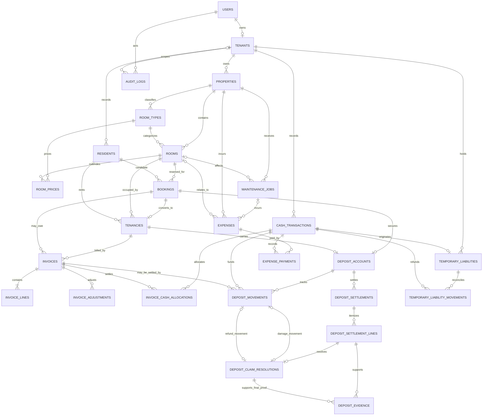

# Skema Relasional KostKita

## Status dan batas dokumen

Dokumen ini menetapkan baseline skema relasional untuk MVP berdasarkan [Model Data Konseptual](model.md) dan aturan bisnis yang ditautkan di dalamnya. Ini desain untuk implementasi migration Laravel, bukan migration atau bukti bahwa schema sudah diterapkan. Nama/status berikut adalah kontrak desain; migration harus mempertahankan invariant dan acceptance criteria yang sama.

Keputusan teknis di sini tidak mengubah aturan produk. Untuk setiap topik bisnis, dokumen pemilik topik tetap berwenang. Jika kebutuhan bisnis berubah, revisi aturan bisnis lebih dahulu, lalu sesuaikan schema dan migration.

## Keputusan penyimpanan

- PostgreSQL adalah database produksi; SQLite digunakan untuk lokal dan test. Jalankan test konkurensi/lock yang bergantung pada perilaku PostgreSQL terhadap PostgreSQL, bukan menyimpulkan hasilnya dari SQLite.
- Gunakan primary key integer `BIGINT` melalui pola ID standar Laravel (`$table->id()`). ID yang muncul di URL tidak menggantikan pemeriksaan otorisasi.
- Simpan seluruh nilai uang sebagai `BIGINT` dalam Rupiah utuh; jangan memakai floating-point. Formula prorata menggunakan decimal arithmetic di aplikasi lalu dibulatkan sekali ke Rupiah dengan half-up sesuai [Keuangan dan Laporan](../business/finance.md).
- Gunakan `DATE` untuk tanggal kalender bisnis dan `TIMESTAMPTZ` untuk instant pada PostgreSQL (`timestampsTz()` pada migration Laravel). SQLite menyimpan timestamp sebagai nilai UTC yang dinormalisasi aplikasi; tampilkan dan hitung deadline kalender pada zona waktu `Asia/Jakarta`. Jangan simpan offset lokal sebagai bagian dari waktu bisnis.
- Simpan periode availability sebagai interval setengah terbuka `[start_date, end_date_exclusive)`. Untuk tanggal akhir yang diinput pengguna sebagai hari terakhir kamar dihuni/maintenance, backend menyimpan batas eksklusif pada hari berikutnya dan menampilkan kembali tanggal inklusif.
- Gunakan status string tervalidasi di backend; jangan bergantung pada PostgreSQL enum agar schema dan migration tetap portabel ke SQLite.
- Simpan nilai status dalam bentuk lowercase yang konsisten. Nama status bisnis `NO_SHOW` dipetakan satu-ke-satu ke kode tersimpan `no_show`; perbedaan kapitalisasi ini hanya konvensi representasi, bukan status yang berbeda.
- Gunakan FK, `CHECK`, unique constraint, dan composite FK yang didukung PostgreSQL/SQLite. Aktifkan foreign-key enforcement SQLite pada setiap koneksi test. Aturan rentang/konkurensi lintas baris tetap diperiksa dalam transaksi aplikasi.
- Setiap tenant adalah satu akun Pemilik Kost pada MVP. `tenant_id` eksplisit terdapat di semua tabel tenant-owned. Super Admin tidak memiliki `tenant_id`; akses lintas tenant hanya lewat aksi platform yang diizinkan dan diaudit.

## ERD

Garis pada ERD menunjukkan kardinalitas domain. Composite FK tenant/property di bawah tetap wajib agar relasi tidak dapat menghubungkan record dari tenant berbeda.

## Kamus tabel

Semua tabel di bawah memiliki `id BIGINT`, `created_at`, dan `updated_at`, kecuali jika disebut immutable. Semua tabel tenant-owned memiliki `tenant_id BIGINT NOT NULL`, FK ke `tenants.id`, dan unique key `(tenant_id, id)` agar dapat menjadi target composite FK. Gunakan `ON DELETE RESTRICT` untuk data historis; penghapusan fisik tidak digunakan untuk record finansial atau audit.

### Akun dan data properti

| Tabel | Kolom inti dan aturan |
|---|---|
| `users` | `name`, `email`, `email_normalized`, `password`, `role` (`owner`, `super_admin`), `account_status` (`active`, `suspended`), `email_verified_at`, timestamps. Unique `email_normalized`; CHECK role/status dari daftar tersebut. Jangan menambah autentikasi penyewa/staf pada MVP. |
| `tenants` | `owner_user_id` FK ke `users.id` (unik), `display_name`, timestamps. Satu owner memiliki tepat satu tenant; hanya `users.role=owner` yang boleh menjadi owner. Role diperiksa di service/policy karena FK tidak memvalidasi nilai role. |
| `properties` | `tenant_id`, `name`, `address`/lokasi yang diperlukan, `status` (`active`, `archived`), `archived_at`, timestamps. FK `tenant_id` ke `tenants`; unique `(tenant_id,id)` untuk composite FK. |
| `room_types` | `tenant_id`, `property_id`, `name`, `description` opsional, `status` (`active`, `archived`), timestamps. FK `(tenant_id,property_id)` ke `properties`; unique `(tenant_id,property_id,name_normalized)` dan `(tenant_id,property_id,id)`. |
| `rooms` | `tenant_id`, `property_id`, `room_type_id` nullable, `code`, `operational_status` (`rentable`, `out_of_service`, `archived`), deskripsi/fasilitas yang diperlukan, `archived_at`, timestamps. FK `(tenant_id,property_id)` ke `properties`; bila ada tipe, FK `(tenant_id,property_id,room_type_id)` ke `room_types`. Unique `(tenant_id,property_id,code_normalized)` dan `(tenant_id,property_id,id)` untuk composite FK dari jadwal/tenancy. |
| `room_prices` | `tenant_id`, `property_id`, tepat satu dari `room_id` atau `room_type_id`, `monthly_rent_rupiah BIGINT`, `effective_from DATE`, `effective_until_exclusive DATE` nullable, `created_by`, timestamps. CHECK nominal `> 0`, target tepat satu, dan awal sebelum akhir. FK `(tenant_id,property_id,room_id)` ke `rooms` atau `(tenant_id,property_id,room_type_id)` ke `room_types`. Unique awal periode per target pada kedua key tersebut. Record harga lama tidak ditimpa; periode harga untuk target yang sama tidak boleh overlap. Periode harga kamar dan tipe kamar boleh overlap karena tarif kamar adalah override. |
| `room_facilities` | `tenant_id`, `room_id`, `label`, `normalized_label`. FK `(tenant_id,room_id)` ke `rooms`; unique `(tenant_id,room_id,normalized_label)`. Simpan sebagai baris terstruktur agar fasilitas tidak bergantung pada format JSON berbeda antar database. |

**Aturan harga yang dikonfirmasi:** katalog hanya memberi nilai awal pada saat kesepakatan booking/check-in. Resolusi booking memakai tanggal rencana mulai, check-in langsung memakai tanggal mulai tenancy, dan perubahan harga pada perpanjangan memakai tanggal efektif perpanjangan. Jika tarif tipe kamar dan override kamar sama-sama berlaku pada tanggal efektif yang dipakai, tarif kamar meng-override tarif tipe. Jika override tidak berlaku, gunakan tarif tipe bila tersedia; bila katalog tidak memiliki tarif yang berlaku, pemilik tetap boleh memasukkan harga kesepakatan secara manual. Simpan harga yang benar-benar disepakati sebagai snapshot; perubahan katalog tidak mengubah booking, tenancy, perpanjangan, atau invoice lama.

### Penyewa, booking, dan tenancy

| Tabel | Kolom inti dan aturan |
|---|---|
| `residents` | `tenant_id`, `full_name`, `whatsapp_number`, kontak/catatan opsional, `archived_at`, timestamps. FK tenant; tidak ada password atau nomor KTP/identitas resmi. Nomor WhatsApp tidak harus unik karena keluarga dapat berbagi kontak. |
| `bookings` | `tenant_id`, `property_id`, `room_id`, `resident_id`, `status` (`pending`, `confirmed`, `checked_in`, `cancelled`, `no_show`), `planned_start_date`, `planned_end_exclusive`, `agreed_monthly_rent_rupiah` (snapshot kesepakatan), `check_in_deadline_at` (instant UTC; nilai expiry adalah 00.00 WIB setelah hari grace terakhir), `confirmed_at`, `checked_in_at`, `cancelled_at`, `cancellation_reason` nullable (maksimal 500 karakter), `no_show_at`, `notes`, `created_by`, timestamps. Alasan pembatalan disimpan dan disalin ke nilai audit `old_values`/`new_values`. CHECK rentang valid dan rent positif; FK `(tenant_id,property_id)` ke properti, `(tenant_id,property_id,room_id)` ke kamar, dan `(tenant_id,resident_id)` ke penyewa. Index `(tenant_id,room_id,status,planned_start_date,planned_end_exclusive)` serta `(tenant_id,status,check_in_deadline_at)` untuk expiry. Harga katalog boleh kosong; harga kesepakatan manual tetap disimpan. |
| `booking_grace_extensions` | `tenant_id`, `booking_id`, `old_deadline_at`, `new_deadline_at`, `reason`, `actor_user_id`, `idempotency_key`, `created_at` immutable. FK `(tenant_id,booking_id)` ke booking dan FK aktor ke `users`; unique `(tenant_id,idempotency_key)`; `new_deadline_at > old_deadline_at`. Menyimpan histori setiap perpanjangan sebelum expiry. |
| `tenancies` | `tenant_id`, `property_id`, `room_id`, `resident_id`, `booking_id` nullable unique per tenant, `status` (`scheduled`, `active`, `completed`, `terminated`), `planned_start_date`, `planned_end_exclusive`, `actual_start_date` nullable, `actual_check_in_at` nullable, `actual_checkout_date` nullable (tanggal terakhir penyewa memakai kamar), `checkout_recorded_at`, `terminated_at` nullable UTC instant (waktu terminasi eksplisit, termasuk pembatalan sebelum check-in), `agreed_monthly_rent_rupiah` (snapshot saat perjanjian), `billing_anchor_day` (1–31 dari actual check-in), syarat pembayaran yang diperlukan, `created_by`, timestamps. FK komposit memastikan tenant/properti/kamar/penyewa/booking konsisten; unique `(tenant_id,booking_id)` membatasi satu tenancy per booking. Tenancy `scheduled` memakai rentang rencana untuk reservasi kamar; saat check-in aktual, simpan tanggal mulai aktual dan pertahankan tanggal rencana untuk audit. Pembatalan sebelum check-in mengisi `terminated_at`, bukan `actual_checkout_date`, agar settlement deposit memiliki peristiwa awal tanpa merekam penghuni fiktif. Tarif manual diperbolehkan tanpa record katalog. |
| `tenancy_extensions` | `tenant_id`, `tenancy_id`, `old_planned_end_exclusive`, `new_planned_end_exclusive`, `old_monthly_rent_rupiah`, `new_monthly_rent_rupiah`, `effective_from DATE`, `actor_user_id`, alasan/catatan, `created_at` immutable. FK gabungan ke tenancy; perubahan harga/masa sewa dicatat sebagai event snapshot dan tidak menulis ulang invoice lama. `effective_from` untuk perubahan harga adalah awal siklus bulanan berikutnya, atau siklus saat ini bila perpanjangan tepat pada batas siklus; jangan membuat prorata hanya karena perubahan tarif. |

`actual_checkout_date` adalah hari terakhir ditempati sebagaimana dipahami pengguna; availability dan prorata memakai batas eksklusif sehari sesudahnya. Untuk tenancy `scheduled`, availability memakai `[planned_start_date, planned_end_exclusive)`. Saat aktual check-in, simpan `actual_start_date` menurut tanggal lokal `Asia/Jakarta` dan instant `actual_check_in_at`; billing anchor dan siklus pertama berasal dari `actual_start_date`. Tenancy `active` tetap memblokir kamar setelah `planned_end_exclusive` sampai check-out dicatat. Jika check-out tercatat lebih awal, service menutup periode tinggal pada `[actual_start_date, actual_checkout_date + 1 hari)` dan membuat adjustment prorata berdasarkan hari kalender aktual; saldo invoice dihitung ulang dalam transaksi. Pembatalan tenancy `scheduled` mengisi `terminated_at` UTC dan membiarkan `actual_checkout_date` null. Deadline settlement deposit dimulai dari tanggal lokal peristiwa check-out atau terminasi; status serta periode booking/tenancy bukan input transisi bebas dari klien.

Untuk prorata checkout awal, `used_days` adalah irisan interval hunian aktual `[actual_start_date, actual_checkout_date + 1 hari)` dan siklus invoice; `cycle_days` adalah jumlah hari aktual pada siklus kalender. Nilai prorata = `monthly_rent_snapshot × used_days / cycle_days`, memakai decimal arithmetic dan pembulatan sekali half-up ke Rupiah. Catat tanggal, operand, dan credit/debit adjustment sebagai event tersendiri; invoice dan payment awal tidak ditulis ulang, dan adjustment tidak otomatis memicu refund.

### Tagihan, uang, dan settlement

| Tabel | Kolom inti dan aturan |
|---|---|
| `invoices` | `tenant_id`, tepat satu dari `booking_id` atau `tenancy_id`, `invoice_number`, `idempotency_key`, `issued_at`, `due_date DATE`, `cycle_start_date DATE` dan `cycle_end_exclusive DATE` nullable berpasangan, `billing_anchor_day` nullable untuk siklus sewa, `created_by`, timestamps. FK gabungan ke booking/tenancy; unique `(tenant_id,invoice_number)`, `(tenant_id,idempotency_key)`, dan `(tenant_id,tenancy_id,cycle_start_date,cycle_end_exclusive)`. CHECK satu sumber, rentang siklus berpasangan/valid. Saldo dihitung dari line, adjustment, dan alokasi aktif. Status tampilan `unpaid`, `partial`, `paid`; `overdue` adalah penanda terhitung yang dapat beriringan dengan saldo partial. |
| `invoice_lines` | `tenant_id`, `invoice_id`, `line_number`, `kind` (`rent`, `agreed_charge`, `other`), `description`, `amount_rupiah BIGINT`, `monthly_rent_snapshot_rupiah` nullable, `service_start_date`/`service_end_exclusive` nullable, timestamps. FK `(tenant_id,invoice_id)`; CHECK nominal `> 0`, rent line menyimpan snapshot/periode layanan, dan pasangan tanggal lengkap/valid. Unique `(tenant_id,invoice_id,line_number)`. Jumlah line adalah nominal kewajiban saat diterbitkan; histori tidak ditimpa. |
| `invoice_adjustments` | `tenant_id`, `invoice_id`, `kind` (`credit`, `debit`), `amount_rupiah BIGINT > 0`, `reason`, `proration_start_date`, `proration_end_exclusive`, `used_days`, `cycle_days`, `monthly_rent_snapshot_rupiah` nullable, `reference_adjustment_id` nullable, `idempotency_key`, `created_by`, `created_at` immutable. FK gabungan ke invoice, actor, dan adjustment asal bila ada; unique `(tenant_id,idempotency_key)`. Kredit/prorata atau koreksi membentuk record terpisah; untuk prorata simpan interval dan operand agar hasil bisa direkonsiliasi. Refund kas, bila disetujui, tetap membutuhkan cash transaction outflow tersendiri. |
| `cash_transactions` | Immutable actual cash event: `tenant_id`, `direction` (`in`, `out`), `category` (`rent_receipt`, `mixed_receipt`, `rent_refund`, `deposit_receipt`, `deposit_refund`, `temporary_liability_refund`, `maintenance_expense`, `operating_expense`), `amount_rupiah BIGINT > 0`, `occurred_on DATE`, `method`, `external_reference` nullable, `description`, `recorded_by`, `idempotency_key`, `reversal_of_id` nullable, `created_at`. Setiap row merekam satu transfer aktual; CHECK memasangkan kategori dengan arah. Jika satu receipt dialokasikan ke sewa sekaligus deposit, simpan satu cash event kategori `mixed_receipt`, lalu pecah nilainya pada kedua ledger alokasi; jumlah split harus sama dengan event dan event tetap dihitung satu kali pada total kas. Unique `(tenant_id,idempotency_key)`; FK ke actor dan event asal dalam tenant. Report menjumlahkan tabel ini satu kali saja. Jangan edit/hapus event; koreksi memakai event baru yang tertaut dan tetap dapat diaudit. |
| `invoice_cash_allocations` | `tenant_id`, `cash_transaction_id`, `invoice_id`, `kind` (`allocation`, `reversal`), `amount_rupiah BIGINT > 0`, `reverses_allocation_id` nullable, `idempotency_key`, `created_at` immutable. FK gabungan ke event dan invoice; reversal juga mereferensikan alokasi pada invoice/tenant yang sama. Unique `(tenant_id,idempotency_key)`. Allocation harus memakai event `rent_receipt` atau `mixed_receipt`; reversal harus memakai event outflow `rent_refund`. Total netto alokasi tidak boleh melebihi bagian receipt yang dialokasikan ke sewa atau saldo invoice; payment baru yang melebihi kewajiban ditolak. |
| `deposit_accounts` | Satu account liability per booking/tenancy: `tenant_id`, `booking_id` nullable, `tenancy_id` nullable, `required_amount_rupiah BIGINT`, `created_at`, `updated_at`. Setidaknya satu source wajib ada; unique per `(tenant_id,booking_id)` dan `(tenant_id,tenancy_id)`. Nominal dapat nol jika kesepakatan tidak meminta deposit. Perubahan nominal sebelum pembayaran dikonfirmasi wajib diaudit. Saat konversi booking, isi `tenancy_id` pada account yang sama dan pertahankan `booking_id` serta semua movement sebelumnya; check-in langsung membuat account yang hanya terkait tenancy. |
| `deposit_settlements` | `tenant_id`, `deposit_account_id`, `status` (`draft`, `approved`, `partially_settled`, `finalized`, `late`, `cancelled`), `opened_at`, `statement_issued_at`, `day7_deadline_at`, `day30_deadline_at`, `approved_by` (owner), `approved_at`, `whatsapp_notified_at`, `finalized_at`, timestamps. FK `(tenant_id,deposit_account_id)` ke account; unique parsial `(tenant_id,deposit_account_id) WHERE status <> 'cancelled'` memastikan hanya satu proposal aktif sementara histori draft cancelled tetap tersimpan. Pembatalan draft memerlukan alasan dan audit, tidak membuat movement/cash event, dan mengizinkan proposal pengganti. Deadlines adalah akhir hari kalender Asia/Jakarta yang disimpan sebagai instant UTC. `finalized` berarti semua claim tertahan dan pembayaran yang disetujui telah dicatat aktual; `late` menandai claim yang melewati batas dan belum selesai. |
| `deposit_settlement_lines` | `tenant_id`, `settlement_id`, `kind` (`refund`, `invoice_deduction`, `damage_deduction`, `held_claim`), `amount_rupiah BIGINT > 0`, `reason`, `agreement_basis`, `invoice_id` nullable, `idempotency_key`, `approved_by`, `approved_at`, `created_at` immutable. FK gabungan ke settlement dan invoice; unique `(tenant_id,idempotency_key)` serta `(tenant_id,settlement_id,id)`. Hanya owner boleh menyetujui. Deduction yang tidak merujuk invoice wajib punya alasan dan evidence; nilai `held_claim` tidak melebihi klaim yang didukung. `held_claim` hanya menahan bagian liability untuk investigasi, belum menjadi deduction atau refund sampai ada resolution dan movement aktual. |
| `deposit_claim_resolutions` | `tenant_id`, `settlement_id`, `held_claim_line_id`, `actual_damage_amount_rupiah BIGINT >= 0`, `refund_amount_rupiah BIGINT >= 0`, `damage_movement_id` nullable, `refund_movement_id` nullable, `resolution_basis`, `approved_by`, `approved_at`, `created_at` immutable. Unique `(tenant_id,id)` dan satu row per `(tenant_id,held_claim_line_id)`. FK gabungan memastikan claim, settlement, dan movements berada pada account/tenant yang sama; movement refund/deduction yang dibuat adalah sumber pengurangan liability. Dalam transaksi, aktual kerusakan + refund harus sama dengan nominal yang ditahan, kerusakan tidak melebihi hold, nilai refund positif wajib memakai cash event refund aktual, dan setiap nilai kerusakan positif wajib punya bukti biaya aktual. Jika bukti final tidak ada pada batas hari ke-30, resolve dengan nilai kerusakan nol dan refund seluruh hold; tidak ada refund otomatis oleh scheduler. |
| `deposit_evidence` | `tenant_id`, `settlement_line_id` nullable, `claim_resolution_id` nullable, `cash_transaction_id` nullable, tepat satu dari tiga parent, `storage_key`, `original_filename`, `mime_type`, `sha256`, `uploaded_by`, `created_at`. FK komposit ke settlement line, claim resolution, atau cash transaction; checksum yang sama tidak boleh dilampirkan dua kali pada satu cash event. Bukti penerimaan eksternal dan refund sewa disimpan bersama cash transaction terkait. Berkas berada di storage privat dan hanya diunduh melalui route tenant-scoped; jangan masukkan ke URL publik tanpa otorisasi. Tidak menyimpan identitas resmi penyewa. |
| `deposit_movements` | Immutable liability ledger: `tenant_id`, `deposit_account_id`, `kind` (`receipt`, `refund`, `invoice_settlement`, `damage_deduction`, `reversal`), `amount_rupiah BIGINT > 0`, `cash_transaction_id` nullable, `settlement_line_id` nullable, `invoice_id` nullable, `reversal_of_movement_id` nullable, `reason`, `actor_user_id`, `approved_by`, `idempotency_key`, `created_at`. FK gabungan ke account, cash event, settlement line/invoice, dan movement asal dalam account yang sama; unique `(tenant_id,idempotency_key)`. `receipt` dan `refund` wajib tertaut ke event kas dengan kategori/arah sesuai; `receipt` dapat memakai event `deposit_receipt` atau bagian deposit dari `mixed_receipt`; `invoice_settlement` wajib ke invoice tanpa cash event; deduction harus ke settlement line yang disetujui. `reversal` meniadakan effect movement yang dirujuk dan tidak menghapus sejarah. Saldo dihitung dari receipt dikurangi refund/deduction/noncash settlement, ditambah effect reversal. |
| `temporary_liabilities` | `tenant_id`, `source_cash_transaction_id`, `resident_id` nullable, `booking_id` nullable, `tenancy_id` nullable, `initial_amount_rupiah BIGINT > 0`, `created_at`. FK gabungan ke cash event dan sumber tenant; unique `(tenant_id,source_cash_transaction_id)`. Menampung hanya bagian kelebihan dari dana yang memang telah diterima di luar validasi aplikasi; tidak otomatis dialihkan ke sewa/deposit. |
| `temporary_liability_movements` | `tenant_id`, `temporary_liability_id`, `kind` (`refund`, `reversal`), `amount_rupiah BIGINT > 0`, `cash_transaction_id` nullable, `reversal_of_movement_id` nullable, `reason`, `actor_user_id`, `approved_by`, `idempotency_key`, `created_at` immutable. FK gabungan ke liability, cash event, dan movement asal; unique `(tenant_id,idempotency_key)`. `refund` wajib memakai event `temporary_liability_refund`; reversal meniadakan movement yang dirujuk. Saldo adalah initial amount dikurangi refund bersih. Kelebihan tidak otomatis diubah menjadi sewa/deposit. |

Invoice balance dihitung dari jumlah `invoice_lines` ditambah debit adjustment dikurangi credit adjustment, netto alokasi kas, dan movement deposit `invoice_settlement` yang disetujui. Refund pembayaran sewa memiliki cash transaction outflow `rent_refund` serta allocation-reversal yang terkait; histori event dan allocation lama tetap ada. Saldo deposit adalah penerimaan aktual pada satu account dikurangi refund, invoice settlement, dan deduction, lalu ditambah effect reversal; `required_amount_rupiah` adalah target kewajiban, bukan saldo kas/liability yang sudah diterima. Receipt/refund cash ditautkan ke event yang sama pada `cash_transactions` dan tidak dibuat event kedua. Kelebihan penerimaan eksternal dicatat sebagai satu cash transaction `deposit_receipt` sebesar nilai penuh, lalu di-split ke `deposit_movements` dan `temporary_liabilities`; jumlah bagian ledger harus sama dengan nominal event kas. Untuk `mixed_receipt`, jumlah allocation `invoice_cash_allocations` ditambah receipt `deposit_movements` harus sama dengan nominal parent event; setiap alokasi tetap dibatasi oleh saldo kewajiban masing-masing. Seluruh event dan alokasi ditulis dalam satu transaksi database. Total Arus Kas Bersih menjumlahkan setiap `cash_transactions` parent satu kali. Rincian kategori sewa, deposit, dan temporary liability dihitung dari subledger yang diagregasi terpisah, bukan join mentah yang menggandakan penerimaan.

Rekonsiliasi kas per event harus memenuhi: `rent_receipt` dialokasikan seluruhnya ke satu atau lebih invoice; `deposit_receipt` dipecah penuh menjadi penerimaan deposit dan, bila ada overpayment eksternal, temporary liability; `mixed_receipt` dipecah penuh antara invoice sewa dan deposit; `maintenance_expense`/`operating_expense` dialokasikan penuh ke expense terkait; refund dihubungkan ke movement/alokasi yang dikembalikan. Pembayaran baru yang melebihi saldo invoice/deposit ditolak. Deposit yang telah dibayar saat booking tetap pada `deposit_account` yang sama setelah check-in; perubahan relasi booking→tenancy bukan receipt baru. `invoice_settlement` dari deposit adalah movement non-kas dan tidak mengubah `cash_transactions` atau Arus Kas Bersih.

### Maintenance, pengeluaran, dan audit

| Tabel | Kolom inti dan aturan |
|---|---|
| `maintenance_jobs` | `tenant_id`, `property_id`, `room_id` nullable, `category`, `description`, `status` (`reported`, `scheduled`, `completed`, `cancelled`), `blocks_room`, `scheduled_start_date`, `scheduled_end_exclusive`, `completed_at`, `vendor_name` nullable, `created_by`, timestamps. Status mengikuti alur domain MVP: dilaporkan, dijadwalkan, selesai, atau dibatalkan. FK komposit ke properti dan kamar. Jika `blocks_room=true`, kamar wajib dipilih dan kedua tanggal jadwal wajib ada dengan rentang valid; hanya pekerjaan demikian yang memblokir availability. |
| `expenses` | `tenant_id`, `property_id`, `room_id` nullable, `maintenance_job_id` nullable, `kind` (`maintenance`, `operational`), `category`, `description`, `amount_due_rupiah BIGINT > 0`, `incurred_on DATE`, `created_by`, timestamps. FK komposit ke properti/kamar/job. Catatan expense belum berarti kas sudah keluar. |
| `expense_payments` | Alokasi immutable dengan `tenant_id`, `expense_id`, `cash_transaction_id`, `kind` (`allocation`, `reversal`), `amount_rupiah BIGINT > 0`, `reverses_payment_id` nullable, `idempotency_key`, `created_at`. FK komposit ke expense, event, dan alokasi asal bila reversal; unique `(tenant_id,idempotency_key)`. Allocation memakai event outflow kategori sesuai jenis expense; total netto tidak melebihi kewajiban. Hanya alokasi aktual ini yang memasukkan pembayaran maintenance/operasional ke cash report. |
| `audit_logs` | `tenant_id` nullable untuk aksi platform, `actor_user_id`, `action`, `subject_type`, `subject_id`, `old_values`/`new_values` yang telah disanitasi, `reason`, `occurred_at` UTC, `request_id`. FK ke tenant bila terisi dan actor ke `users`; append-only. Aksi finansial, status, tenant, harga, dan keputusan platform wajib diaudit. Jangan menyimpan password, token, KTP, atau rahasia `.env`. |

## Constraint dan invariant lintas tabel

Constraint berikut harus dijaga oleh foreign key/check di database bila portabel, dan selalu divalidasi ulang pada service Laravel:

1. Setiap FK tenant-owned menggunakan pasangan `(tenant_id, parent_id)` menuju unique key parent yang memuat `tenant_id`. Relasi room/property/type, booking/room/resident, tenancy/booking, invoice/source, deposit/account, expense/property/room, dan allocations tidak boleh lintas tenant.
2. Role `owner` mempunyai tepat satu tenant; `super_admin` tidak mempunyai tenant owner record. Pemilik memperoleh `tenant_id` dari user terautentikasi, bukan request, route body, atau query string.
3. Kode kamar unik per properti. Nominal wajib positif untuk cash movement/invoice line/expense/deposit movement, tidak negatif untuk `required_amount` yang dapat bernilai nol saat kesepakatan tidak meminta deposit.
4. Periode memiliki `start < end_exclusive`; interval maintenance, booking, tenancy, harga efektif, dan invoice tidak boleh kosong/terbalik.
5. Booking `pending`, `cancelled`, dan `no_show` tidak memblokir. `confirmed` memblokir sampai check-in/cancel/expiry no-show; sebelum availability diputuskan, backend merekonsiliasi booking confirmed yang sudah melewati `check_in_deadline_at` menjadi `no_show`, walau Scheduler terlambat. Tenancy `scheduled` dan `active` memblokir; `active` tidak otomatis selesai saat planned end lewat. Record archive tidak menghapus pemblokir historis atau finansial.
6. Pembayaran booking adalah receipt deposit jaminan yang sama. Konversi booking ke tenancy membuat/menautkan tenancy dan mengisi tenancy_id pada `deposit_accounts` yang ada dalam satu transaksi; jangan membuat receipt atau account liability kedua.
7. Cash report menghitung setiap `cash_transactions` parent satu kali. `rent_receipt` hanya dialokasikan ke invoice; `deposit_receipt` dipecah ke deposit/temporary-liability ledger; `mixed_receipt` harus memiliki alokasi invoice dan deposit yang jumlahnya bersama-sama sama dengan nominal event. Deposit receipt masuk cash inflow sekaligus liability; deposit refund dan temporary-liability refund adalah cash outflow liability; rent refund adalah cash outflow sesuai kategori refund; deposit yang dipakai melunasi invoice tidak membuat cash transaction. Expense masuk cash outflow hanya melalui actual `expense_payments`.
8. Invoice status/saldo serta deposit/expense/temp liability balances dihitung dari amount dan allocations/movements aktif. Jika performa memerlukan cache, cache adalah derived/rebuildable dan bukan ledger source of truth.
9. Setiap account atau transaction finansial historis dilarang dihapus/cascade. Gunakan reversal, refund, correction, atau adjustment baru dengan foreign key ke event awal dan audit trail.

### Peta FK tenant dan CHECK portabel

FK komposit wajib dipakai pada relasi berikut. Kolom aktor mengacu ke `users.id`; service tetap memeriksa bahwa aktor berwenang untuk tenant terkait.

| Tabel anak | Target FK |
|---|---|
| `room_types` | `(tenant_id,property_id)` → `properties` |
| `rooms` | `(tenant_id,property_id)` → `properties`; `(tenant_id,property_id,room_type_id)` → `room_types` bila tipe terisi |
| `room_prices` | `(tenant_id,property_id)` → `properties`; tepat satu target `(tenant_id,property_id,room_id)` → `rooms` atau `(tenant_id,property_id,room_type_id)` → `room_types` |
| `room_facilities` | `(tenant_id,room_id)` → `rooms` |
| `bookings` | `(tenant_id,property_id)` → `properties`; `(tenant_id,property_id,room_id)` → `rooms`; `(tenant_id,resident_id)` → `residents` |
| `booking_grace_extensions`, `tenancy_extensions` | `(tenant_id,booking_id)` → `bookings`; `(tenant_id,tenancy_id)` → `tenancies` |
| `tenancies` | `(tenant_id,property_id)` → `properties`; `(tenant_id,property_id,room_id)` → `rooms`; `(tenant_id,resident_id)` → `residents`; `(tenant_id,booking_id)` → `bookings` bila ada |
| `invoices` | `(tenant_id,booking_id)` → `bookings` atau `(tenant_id,tenancy_id)` → `tenancies`, tepat satu sumber |
| `invoice_lines`, `invoice_adjustments`, `invoice_cash_allocations` | `(tenant_id,invoice_id)` → `invoices`; alokasi juga `(tenant_id,cash_transaction_id)` → `cash_transactions` dan reversal ke alokasi asal pada tenant/invoice yang sama |
| `deposit_accounts` | `(tenant_id,booking_id)` → `bookings` dan/atau `(tenant_id,tenancy_id)` → `tenancies`; minimal salah satu sumber |
| `deposit_settlements`, `deposit_movements` | `(tenant_id,deposit_account_id)` → `deposit_accounts`; movement juga mengacu ke cash event/settlement line/invoice yang sesuai dan movement asal pada account yang sama |
| `deposit_settlement_lines` | `(tenant_id,settlement_id)` → `deposit_settlements`; `(tenant_id,invoice_id)` → `invoices` bila terkait; `(tenant_id,settlement_id,id)` menjadi target FK resolution claim |
| `deposit_evidence` | Evidence menunjuk tepat satu parent: `(tenant_id,settlement_line_id)` → `deposit_settlement_lines`, `(tenant_id,claim_resolution_id)` → `deposit_claim_resolutions`, atau `(tenant_id,cash_transaction_id)` → `cash_transactions`; tidak memiliki `settlement_id` langsung |
| `deposit_claim_resolutions` | `(tenant_id,settlement_id,held_claim_line_id)` → held-claim line pada settlement; `(tenant_id,damage_movement_id)` / `(tenant_id,refund_movement_id)` → `deposit_movements` bila movement ada; maks. satu resolution per held claim |
| `temporary_liabilities`, `temporary_liability_movements` | Sumber cash event, resident/booking/tenancy, liability, dan movement asal selalu memakai tenant yang sama |
| `maintenance_jobs`, `expenses`, `expense_payments` | Properti, kamar, job servis, expense, cash event, dan allocation reversal memakai composite FK tenant yang sama |
| `audit_logs` | `tenant_id` → `tenants` bila bukan NULL; actor → `users`. Baris platform boleh tidak memiliki tenant. |

Gunakan `CHECK` yang hanya melihat baris saat ini, karena bentuk tersebut didukung kedua database. Baseline check mencakup: amount wajib `> 0` dan `required_amount_rupiah >= 0`; status/role/kind/direction berada dalam allowlist string; pasangan tanggal nullable terisi bersama; batas interval valid; tepat satu target katalog dan tepat satu sumber invoice; minimal satu sumber deposit; rent line membawa snapshot dan rentang layanan valid; jadwal pemblokir memiliki kamar serta kedua tanggal valid; invoice prorata mempunyai `0 < used_days <= cycle_days`; bukti menunjuk tepat satu parent; serta kategori `rent_receipt`/`mixed_receipt`/`deposit_receipt` hanya `in` dan refund/expense hanya `out`. Nilai uang disimpan sebagai integer Rupiah. Batas lintas-row seperti total alokasi, non-overlap tanggal, kesamaan nilai resolution claim dengan (deduction + refund), peran owner pada FK aktor, atau keadaan lifecycle tidak dapat dijaga `CHECK` biasa; jaga di service Laravel di dalam transaksi dan buktikan dengan acceptance tests.

## Uniqueness, availability, dan concurrency

- Untuk perubahan yang dapat menambah atau mengubah pemblokir availability—booking confirmed/cancel/no-show, check-in, perubahan periode, grace extension, tenancy, maintenance, serta archive properti/kamar—mulai transaksi dan ambil lock dalam urutan stabil: row properti tenant-owned sebagai mutex bersama, row `rooms` terkait menurut ID, lalu record booking/tenancy/maintenance menurut ID. Baca ulang status/deadline dan semua pemblokir setelah lock; evaluasi overlap pada interval `[start,end_exclusive)`; simpan hanya jika tidak konflik; rollback penuh saat konflik. Semua penulis blocker dan archive harus mengambil row mutex properti yang sama; tanpa itu, pemeriksaan blocker saat archive dapat berlomba dengan pembuatan booking atau jadwal servis. Scheduler no-show juga mengikuti urutan lock tersebut dan mengubah status hanya jika booking masih confirmed serta `check_in_deadline_at <= now_utc`; operasi berulang tidak boleh menghasilkan transisi atau ledger ganda.
- SQLite tidak menyediakan row lock PostgreSQL yang setara. Test SQLite memverifikasi aturan domain non-concurrent; acceptance test paralel availability/no-show harus dijalankan pada PostgreSQL dengan connection/transaction terpisah. Retry deadlock/serialization failure terbatas dan seluruh service tetap idempotent.
- Indeks lookup availability: `(tenant_id,room_id,status,planned_start_date,planned_end_exclusive)` pada booking; `(tenant_id,room_id,status,planned_start_date,planned_end_exclusive)` untuk tenancy `scheduled`; `(tenant_id,room_id,status,actual_start_date,actual_checkout_date)` untuk tenancy aktif/berakhir; serta indeks jadwal maintenance `(tenant_id,room_id,status,scheduled_start_date,scheduled_end_exclusive)`. Query tetap melakukan pemeriksaan overlap: `existing.start < requested.end_exclusive AND existing.end_exclusive > requested.start`.
- Untuk invoice bulanan, hitung `cycle_start_date`/`cycle_end_exclusive` dengan aritmetika kalender dari billing anchor check-in; `due_date` sama dengan `cycle_start_date`, bukan fixed 30 hari atau grace period. Bila anchor 29–31 tak tersedia pada bulan itu, gunakan hari terakhir bulan; jangan ubah original `billing_anchor_day`. Unique `(tenant_id,tenancy_id,cycle_start_date,cycle_end_exclusive)` dan `(tenant_id,idempotency_key)` menjadi benteng idempotensi; generator membuat invoice dan seluruh line dalam transaksi, menangani unique-conflict sebagai “sudah dibuat”, bukan membuat duplikat. Simpan anchor `1..31` di tenancy dan snapshot pada invoice.
- Untuk payment, settlement, expense payment, dan refund: gunakan idempotency key unik per tenant untuk request/API form submission; lock obligation/account dan hitung ulang saldo; tolak alokasi baru melebihi saldo; catat cash event dan seluruh alokasi/movement secara atomik. Saldo dihitung ulang sebelum commit.
- Untuk perubahan harga katalog: serialisasikan update pada target room/type, periksa ulang interval efektif yang telah tersimpan, lalu tolak overlap pada target yang sama. Overlap room-price dengan type-price diizinkan karena aturan override menentukan tarif yang dipilih.
- Database uniqueness tidak cukup untuk overlap tanggal arbitrer. PostgreSQL range/exclusion constraint boleh ditambahkan sebagai defense-in-depth pada migration khusus PostgreSQL, tetapi bukan satu-satunya kontrol dan tidak boleh membuat SQLite menjalankan perilaku yang berbeda.

## Indeks minimum

Selain FK, unique keys, dan indeks availability di atas:

- `properties(tenant_id,status)`; `rooms(tenant_id,property_id,operational_status)`.
- `room_prices(tenant_id,property_id,effective_from,effective_until_exclusive)` untuk mencari katalog aktif.
- `bookings(tenant_id,status,planned_start_date)` dan `(tenant_id,status,check_in_deadline_at)`.
- `tenancies(tenant_id,status,planned_end_exclusive)`, `(tenant_id,resident_id,planned_start_date)`, serta indeks availability berbasis tanggal rencana/aktual di atas.
- `invoices(tenant_id,due_date)` dan `(tenant_id,tenancy_id,cycle_start_date)`.
- `cash_transactions(tenant_id,occurred_on,direction,category)`.
- `deposit_movements(tenant_id,deposit_account_id,created_at)`; `deposit_settlements(tenant_id,status,day7_deadline_at,day30_deadline_at)`.
- `temporary_liability_movements(tenant_id,temporary_liability_id,created_at)`.
- `expenses(tenant_id,property_id,incurred_on,category)`.
- `audit_logs(tenant_id,occurred_at)` dan `(actor_user_id,occurred_at)`.

Indeks tambahan harus didasarkan pada query/list/report yang benar-benar digunakan; hindari menambahkan index redundan pada prefix unique/index lain.

## Retensi dan implementasi

- `users` pemilik dinonaktifkan/suspended, bukan dihapus. Tenant, properti, kamar, residents, dan master data diarsipkan agar histori tetap dapat dibaca dan dibatasi.
- Record booking, tenancy, invoice, cash transaction, allocation, deposit, expense payment, dan audit bersifat historis/append-only setelah diposting. Koreksi menggunakan record baru yang tertaut.
- Kumpulkan hanya nama dan kontak yang diperlukan untuk operasional penyewaan; jangan menyimpan nomor KTP/identitas resmi. Bukti settlement disimpan di private storage dan diotorisasi tenant-side.
- Migration Laravel harus membuat FK komposit/constraint dengan SQL yang didukung kedua database, menambahkan index, dan memberi default waktu UTC. Jika satu constraint memerlukan SQL spesifik PostgreSQL, dokumentasikan sebagai defense-in-depth opsional, bukan satu-satunya penjaga invariant.
- Sebelum migration dibuat, tinjau schema ini bersama kontrak route/action dan acceptance matrix di [Strategi Kualitas](../quality/testing.md). Implementasi wajib menjaga nama domain/status dari dokumen bisnis walaupun nama kolom internal berbeda.
